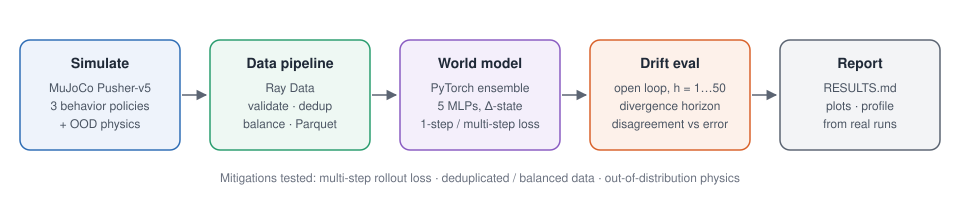
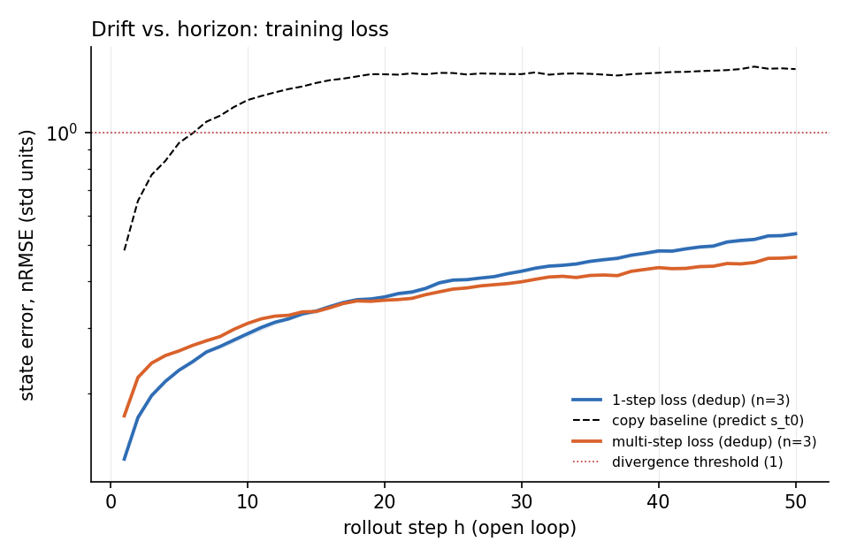
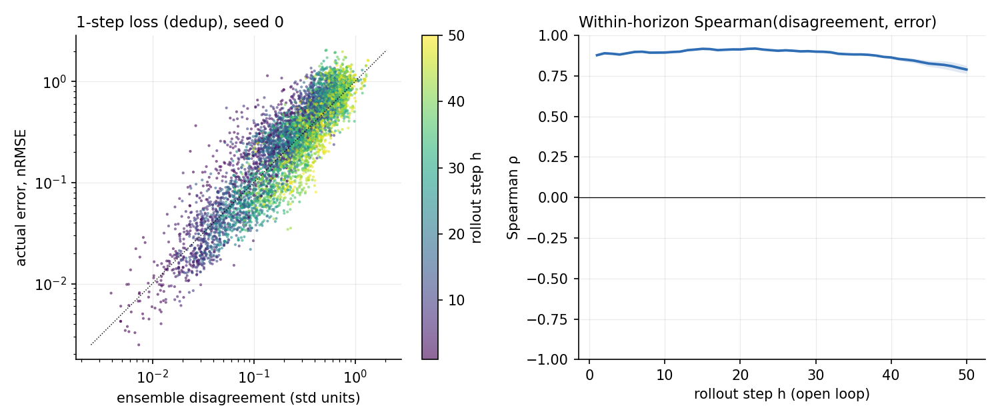
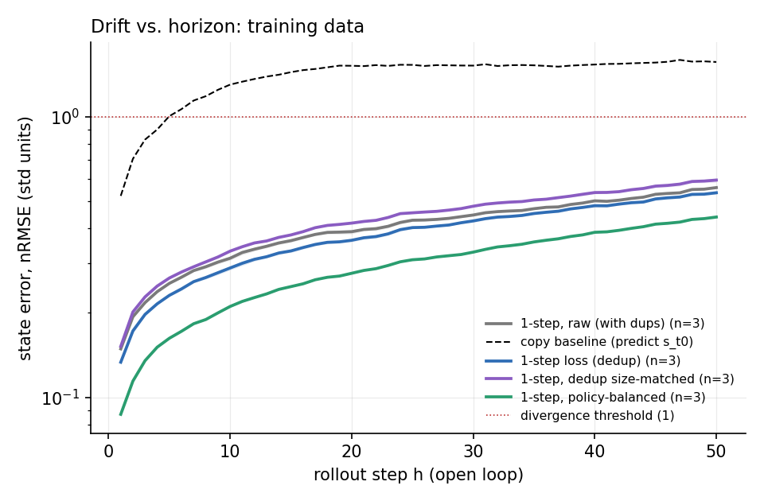
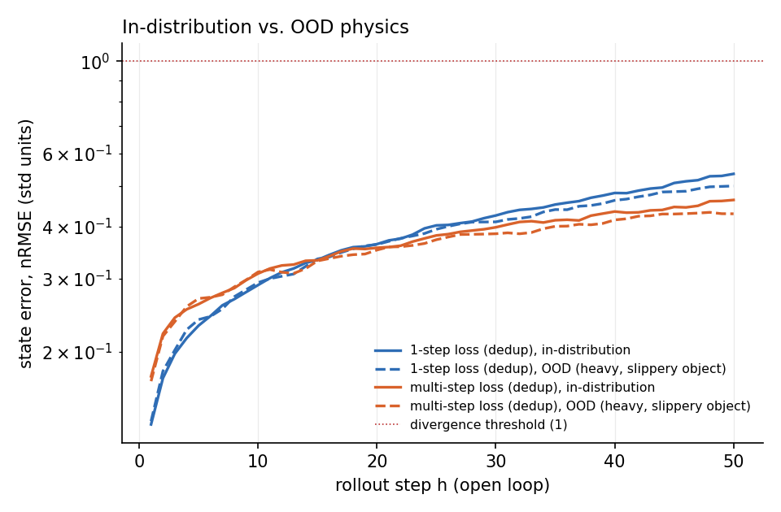
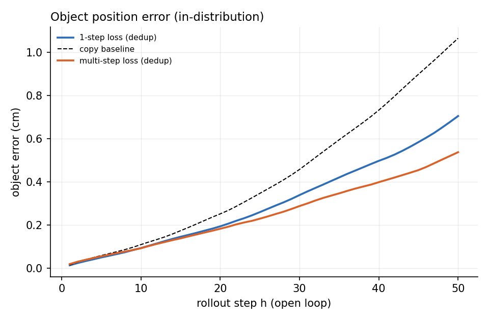

# DriftBench — measuring rollout drift in learned world models

Train a small action-conditioned world model on MuJoCo manipulation data, measure how its predictions drift over long open-loop rollouts, and test what reduces that drift.



## Results at a glance

These plots are generated by `python -m driftbench.report` from the latest full run. Exact numbers, seeds and hardware are in **[`results/RESULTS.md`](results/RESULTS.md)**; this README deliberately contains no hand-typed metrics.

| How fast does error compound, and does a multi-step loss help? | Does the ensemble know when it's wrong? |
|---|---|
|  |  |
| **Does the training data matter?** | **What happens under unseen physics?** |
|  |  |



## Quick start

Python 3.10–3.12 recommended (Ray wheels lag behind the newest Python).

```bash
python -m venv .venv
# Windows: .venv\Scripts\activate      macOS/Linux: source .venv/bin/activate
pip install -r requirements.txt

python run_all.py --quick     # smoke test, a few minutes; numbers are meaningless
python run_all.py             # the real run
```

Then open `results/RESULTS.md` (VS Code: right-click → *Open Preview*).

If Ray gives you trouble on your machine, run the pipeline without Ray instead; it uses the same batch functions:

```bash
python run_all.py --engine local
```

GPU is used automatically if PyTorch sees one (`--device cpu` to force CPU). Add `--compile` to also profile `torch.compile`.

### Running stages individually

```bash
python -m driftbench.collect                 # 1. simulate          -> data/raw/
python -m driftbench.pipeline                # 2. Ray Data pipeline -> data/processed/, results/data_stats.json
python -m driftbench.experiments             # 3. train + evaluate  -> results/runs/<exp>/seed<k>/
python -m driftbench.profile_train           # 4. profile training  -> results/profile.json
python -m driftbench.report                  # 5. tables + plots    -> results/RESULTS.md, results/plots/
```

Every module takes `--help`. Experiment runs are cached, so if a long run is interrupted, rerun the same command and it resumes (`--force` retrains).

## What each stage does

### 1. Simulation (MuJoCo, `collect.py`)
Gymnasium's `Pusher-v5`: a 7-DoF arm pushing a cylinder toward a goal. Observations are 23-D (joint positions and velocities, fingertip, object, goal); episodes are 100 steps. Three behaviour policies give the dataset a diversity axis:

| policy | behaviour |
|---|---|
| `scripted` | Jacobian-transpose controller: get behind the object, push toward the goal. Deterministic given the start state. |
| `noisy` | Same controller with randomised gains, Gaussian torque noise and 15% random actions. |
| `random` | Uniform random torques. |

The train split is deliberately imbalanced (mostly scripted), like real logged robot data. Held-out eval sets have equal counts per policy, with separate seeds. The **OOD** eval set uses a modified physics variant: object 4× heavier, 0.25× sliding friction.

`results/collection_stats.json` reports how well the scripted controller actually pushes (final object-goal distance, success rate). It does not need to solve the task; it needs to produce purposeful, contact-rich motion. If it barely moves the object, tune `ScriptedPusher.KP/KD` in `policies.py`.

**Disclosed synthetic data problems.** To give the pipeline something real to catch, the train split has (a) retry duplicates: 25% of scripted jobs are re-run with the same seed, as if a worker crashed after writing and got retried; and (b) faults: 2% of episodes are truncated or have a NaN written in. Both are counted in `data_stats.json`, so you can check that the pipeline catches what was injected.

### 2. Data pipeline (Ray Data, `pipeline.py`)
`read_parquet → validate (length, shape, NaN/inf, range) → hash → groupby(hash).map_groups(keep_first) → write sharded Parquet`.

Near-duplicate detection hashes a quantized (2 cm bins), temporally downsampled (every 10th step) copy of each trajectory's fingertip and object positions. Exact-duplicate counts are reported alongside as a correctness check against the injected retries. Outputs:

| dataset | contents |
|---|---|
| `raw` | validated, duplicates kept |
| `dedup` | near-duplicates removed |
| `balanced` | dedup, downsampled to equal episodes per policy |
| `dedup_matched` | dedup, random subsample the **same size** as `balanced` (control) |

### 3. World model (PyTorch, `model.py`, `train.py`)
Ensemble of 5 MLPs (3×200, SiLU) predicting normalised next-state deltas from (state, action). The ensemble is one batched matmul per layer, not 5 Python calls. Each member trains on its own bootstrap resample of episodes. Dimensions that do not move (the goal, the object's height) are predicted as unchanged and excluded from losses and metrics.

Loss for training horizon H (H=1 is ordinary teacher-forced delta MSE):

    L = 1/H · Σ_k  mean( ((ŝ_k − s_k) / σ_Δ)² ),   ŝ_k fed back from the model's own prediction

### 4. Drift evaluation (`evaluate.py`)
From 4 random start states per held-out episode, each ensemble member rolls out 50 steps open loop, replaying the recorded actions. Metrics:

- **nRMSE vs. horizon**: ensemble-mean error in units of training-set state std. 1.0 ≈ "no better than predicting the dataset mean."
- **Divergence horizon**: first step where mean nRMSE > 1.0 (configurable with `--threshold`).
- **Copy baseline**: predict the start state forever. A model that loses to this isn't modelling the dynamics.
- **Object position error** in centimetres, the quantity a pushing planner cares about.
- **Does ensemble disagreement predict actual error?** Spearman correlation and AUROC, reported both pooled and **within each horizon**. Disagreement and error both grow with h, so the pooled number is inflated by horizon alone; the within-horizon number is the real test of "does the model know when to stop trusting itself."

### 5. Mitigation experiments (`experiments.py`)
Each runs for 3 seeds by default:

| experiment | question |
|---|---|
| `h1_dedup` vs `h10_dedup` | Does a 10-step rollout loss push the divergence horizon out? (same number of gradient steps; H=10 costs ~10× compute per step) |
| `h1_raw` vs `h1_dedup` | Do duplicates hurt, or just waste compute? |
| `h1_balanced` vs `h1_matched` | Does policy balance help, holding dataset size fixed? |
| all models on `eval_ood` | How much faster does drift happen under unseen physics, and does disagreement rise to flag it? |

### 6. Performance pass (`profile_train.py`)
Compares a textbook `Dataset`/`DataLoader` training step against the vectorised on-device sampler that `train.py` uses (and optionally `torch.compile`). Data and compute time are measured separately, and a `torch.profiler` table plus Chrome trace are saved to `results/profile/`. The report states whatever the profiler finds to be the bottleneck rather than assuming it.

## Repo layout

```
driftbench/
  config.py         paths, obs layout, physics variants
  policies.py       random / scripted / noisy controllers, OOD physics patch
  collect.py        stage 1: parallel episode collection -> Parquet
  pipeline.py       stage 2: Ray Data validate/dedup/balance (+ local pandas engine)
  data.py           load Parquet -> arrays, normalisation stats
  model.py          batched ensemble MLP dynamics model
  train.py          vectorised window sampler, 1-step / multi-step loss
  evaluate.py       open-loop rollouts, drift + uncertainty metrics
  experiments.py    stage 3: experiment grid, cached per run
  profile_train.py  stage 4: profiling
  report.py         stage 5: RESULTS.md + plots, generated from run files
run_all.py          end-to-end runner
```

## Honesty rules this repo follows
1. No hand-typed results. `RESULTS.md` is regenerated from `metrics.json`, `data_stats.json` and `profile.json`.
2. The device (CPU/GPU, model name), library versions and timestamp are stored with every run and printed in the report header.
3. Synthetic data problems (retries, faults) are disclosed and counted.
4. Controls are included where a comparison would otherwise be confounded: the copy baseline, the size-matched data subset, and the within-horizon correlation.
5. `--quick` output is labelled as a smoke test. Quote only full-run numbers.

## Knobs worth knowing

| flag | where | default |
|---|---|---|
| `--scale` | collect | 1.0 (multiply episode counts) |
| `--quantum`, `--stride` | pipeline | 0.02 m, 10 steps (near-dup sensitivity) |
| `--steps`, `--seeds` | experiments | 6000, `0 1 2` |
| `--multi-horizon` | experiments | 10 |
| `--eval-horizon`, `--threshold` | experiments | 50, 1.0 |
| `--threads` | experiments | torch default (set on CPU if your laptop is busy) |

## Troubleshooting
- **`Pusher-v5` not found**: you need `gymnasium>=1.0` with the `mujoco` extra.
- **Ray errors or hangs on Windows**: use `--engine local` for the pipeline. The batch logic is identical; only the balanced/matched random subsets will differ.
- **`torch.compile` fails**: expected without a C++ toolchain (common on Windows). The failure is recorded in `profile.json` and the other variants still run.
- **Multiprocessing errors in collection**: run from a terminal with `python -m ...` or `python run_all.py`, not by pressing "Run" on a module file inside the package.
- **Changed a setting and results didn't change?** Experiment runs are cached; add `--force`.

## Limitations and next steps
- State-based only. The pixel-based latent model (CNN encoder + GRU dynamics on 64×64 renders) from the original plan is **not implemented** yet; it is the natural next step toward video world models.
- Deterministic ensemble (MSE). A probabilistic ensemble (Gaussian NLL) would separate aleatoric from epistemic uncertainty.
- Quantized hashing misses near-duplicates that straddle a bin edge. MinHash/LSH over trajectory windows would be more robust.
- Open-loop replay of logged actions measures pure model drift. Closed-loop evaluation (MPC with the model) would measure whether the drift matters for control.

## The one-paragraph pitch
"World models. I built a small version of your drift example: a MuJoCo world model where I measured how prediction error compounds over open-loop rollouts, tested which training changes push the divergence horizon out, and checked whether ensemble disagreement tells you when to stop trusting a rollout. In week one I'd want to run the same analysis on your real rollouts."
